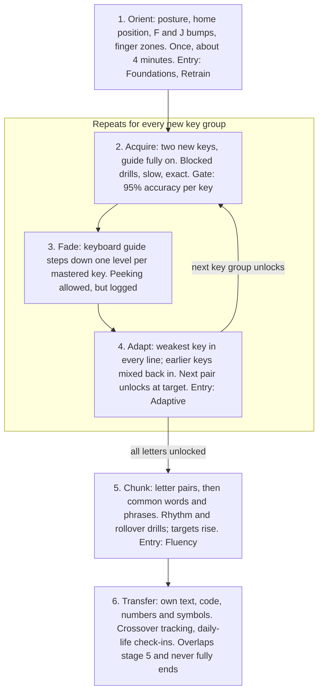

# Learning method

## What the research says, and what EyesUp does about it

Touch typing is a motor skill, so the method borrows from motor-learning and typing research rather than from flashcard-style memorisation. Every design rule below traces to a finding.

| Finding | Source | What EyesUp does |
| --- | --- | --- |
| Skilled typists cannot reliably say where keys are; the knowledge lives in the fingers, not in a mental map. Learners who finish a tutorial gain little explicit layout knowledge either. | [Liu, Crump & Logan 2010](https://pubmed.ncbi.nlm.nih.gov/20516227/); [Snyder et al. 2013](https://doi.org/10.3758/s13414-013-0548-4) | No "memorise the keyboard" quizzes. Every exercise is a keystroke; the chart is a guide that fades, never a test. |
| Skilled typing is planned a word at a time; fingers prepare upcoming letters in parallel. | [Crump & Logan 2010](https://www.crumplab.com/publications/Crump/files/4704/Crump%20and%20Logan%20-%202010%20-%20Hierarchical%20control%20and%20skilled%20typing%20Evidence%20.pdf) | Move from single keys to letter pairs to words as early as accuracy allows. |
| Fast typists overlap keypresses (rollover) on 40–70% of keystrokes, make fewer errors, and are best predicted by how fast they type letter pairs split across hands or fingers. | [Dhakal et al. 2018](https://userinterfaces.aalto.fi/136Mkeystrokes/); [Cambridge summary](https://www.cam.ac.uk/research/news/what-makes-a-faster-typist) | Track pair speed and rollover; drill the slowest pairs; accuracy gates come before speed targets. |
| Speed is predicted by a consistent finger for each key, preparing the next keystroke early, and little whole-hand movement — even in self-taught typists. | [Feit, Weir & Oulasvirta 2016](https://userinterfaces.aalto.fi/how-we-type/) | Teach one fixed finger per key and constant return to home position; flag timing patterns that suggest finger switching. |
| Constant visual guidance tends to create dependence; performance drops when it is removed. Fading the guidance helped transfer in at least one study, though evidence is mixed. | [Guidance hypothesis review](https://link.springer.com/10.1007/s00426-016-0775-0); [fading study](https://hal-sfo.ccsd.cnrs.fr/ISAE-ENSMA/hal-04565437v1); [mixed results](https://pmc.ncbi.nlm.nih.gov/articles/PMC10933749) | The on-screen keyboard fades per key in four levels as mastery grows, and steps back if accuracy slips. |
| Mixed (interleaved) practice feels worse during training but is retained and transferred better than blocked practice. | [Shea & Morgan 1979](https://swov.nl/nl/publicatie/contextual-interference-effects-acquisition-retention-and-transfer-motor-skill) | New keys are drilled in a block; within the same session, earlier keys are mixed back in. |
| Touch-typing graduates often drift back to looking, because looking gives better speed right now. Changing the rewards to favour looking at the screen reduced this. | [Yechiam et al. 2003](https://cris.haifa.ac.il/en/publications/melioration-and-the-transition-from-touch-typing-training-to-ever/) | Rewards scale with how little guidance was used; crossover tracking; practice on the learner's own text. |
| Practice spread over days is retained better than the same amount crammed together. | Spacing effect, well established in memory research (Cepeda et al. 2006) | Short daily sessions by default; a soft daily cap on new-key learning. |

## The method: six stages

The diagnostic decides where each learner enters: Foundations and Retrain at stage 1, Adaptive at stage 4 with known letters pre-unlocked, Fluency at stage 5.

## Fading the guide

The on-screen keyboard fades **per key**, not all at once. A learner halfway through sees mastered keys as blank outlines and new keys in full colour, so the picture itself shows progress.

| Level | What the learner sees for that key | Steps up when | Steps back when |
| --- | --- | --- | --- |
| L0 — Full guide | Finger colour, the next key glows, the hand guide animates the reach | Key is new (first 2 sessions with it) | — |
| L1 — Zones | Finger colour only; no glow, no hands | 95% accuracy over the last 40 presses of that key | Below 90% over 40 presses |
| L2 — Outline | Faint outline, no colour | 95% accuracy and 60% of target speed | Below 90% over 40 presses |
| L3 — Off | Key not drawn | At target speed for 2 sessions in a row | Below 90% over 40 presses |

Two rules keep the fade honest:

- **Peek, don't cheat.** Holding Ctrl (remappable) shows the full keyboard for as long as it is held. Keystrokes typed during a peek count as guided and do not advance the key's level.
- **Blind checks.** Every third session opens with a 30-second run with the whole keyboard hidden. This is the real measure of learning; in-lesson scores with the guide on are only a practice signal.

## Session design

The default is one 12-minute session a day, chosen during onboarding (5, 12 or 20 minutes). Sessions are built from short lines of 20–40 seconds, each followed by a one-line result.

| Block | Share of session | Content | Why |
| --- | --- | --- | --- |
| Warm-up | 10% | Mastered keys, easy words | Settle hands on home position |
| New keys | 30% | The 1–2 newest keys, blocked | Acquire the movement cleanly |
| Mixed review | 30% | All unlocked keys, weakest key in every line | Interleaving and adaptive targeting |
| Words and text | 20% | Real words, phrases, own text later | Word-level planning and transfer |
| Blind check or cool-down | 10% | Keyboard hidden, 30 seconds | Measure learning, not performance |

Other defaults:

- **Errors.** Foundations uses stop-on-error: the line waits until the correct key is pressed, so the wrong movement is never completed. Other tracks mark the error and continue. Backspace is off in drills so statistics stay honest; it is on in free practice.
- **Live speed counter.** Hidden during lines for Foundations and Retrain, shown at the end of each line. Watching a number while learning a movement splits attention.
- **Breaks.** After 20 minutes of continuous typing, a 30-second hand-stretch card appears.
- **Daily cap.** New-key learning stops after 30 minutes a day; free practice and tests stay open.

## Motivation without anxiety

Motivation features reward learning, not grinding, and never punish a missed day harshly.

- **Visible progress:** per-key heatmap, keys-mastered count, and the learner's speed today against their first day.
- **Forgiving streaks:** one missed day a week does not break a streak.
- **Ghost race:** race your own best run on the same text, never strangers by default. Leaderboards exist only in classroom mode.
- **Milestones tied to learning:** first fully blind line, all letters unlocked, crossover reached, first 30 WPM blind.
- **Specific feedback:** "Your right ring finger (O, L, full stop) is 18% faster this week" instead of generic praise.

## Beating the relapse: the crossover plan

Anyone who already types by looking will be slower for a few weeks after switching. That dip is why most of them quit touch typing outside the lesson. EyesUp makes the dip visible, rewards staying eyes-up, and plans the moment blind typing overtakes the old habit.

1. **Record a sighted baseline** during onboarding (probe A).
2. **Show the crossover chart:** blind speed per session against the baseline line, with a projected crossover date from the last 10 sessions.
3. **Pay for eyes-up keystrokes:** practice points scale with the guide level used (L3 keystrokes are worth four times L0), so looking costs something even inside the app.
4. **Commit week:** once all letters are unlocked at 25 WPM blind, the learner can opt into touch typing everywhere for 7 days, with a one-tap daily check-in.
5. **Own-text practice:** paste an email, assignment or code file and practise on it. The text stays on the device.
6. **Practical tip shown in onboarding:** a cloth over the hands or blank keycaps for the first two weeks removes the temptation to look.
