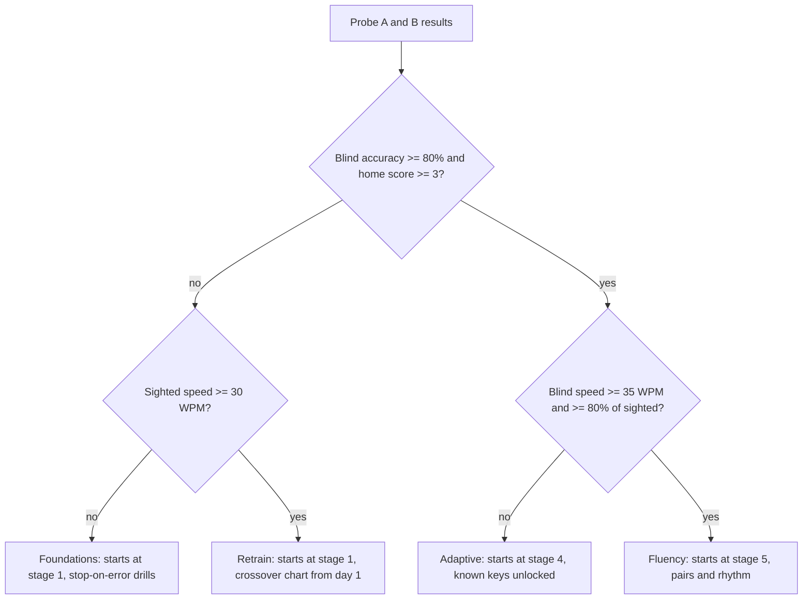

# Onboarding diagnostic

## How onboarding works

Onboarding takes about 3 minutes and ends inside the first lesson, not on a settings page. Self-report sets a starting guess; two short typing probes confirm or overrule it.

1. **Welcome** (10 s): one screen, the promise, a Start button. No account.
2. **Six questions** (about 60 s): one per screen, large illustrated choices, keyboard-navigable.
3. **Probe A — type as you normally do** (45 s): look wherever you like. Also detects the keyboard layout silently.
4. **Probe B — eyes on the screen** (about 60 s): home-position check plus two short blind lines.
5. **Result card**: the track, the reason in one sentence, the detected layout to confirm, and a one-tap "start somewhere else".
6. **First lesson**: Orient for Foundations and Retrain; straight into a session for Adaptive and Fluency.

**Layout detection without asking.** Every keystroke reports both the physical key (`code`) and the character it produced (`key`). Three keys are enough to tell the common layouts apart:

| Layout | KeyQ gives | KeyY gives | KeyE gives |
| --- | --- | --- | --- |
| QWERTY (US, UK) | q | y | e |
| QWERTZ (German) | q | z | e |
| AZERTY (French) | a | y | e |
| Dvorak | ' | f | . |
| Colemak | q | j | f |

US and UK QWERTY differ on symbol keys (the key left of 1, the key beside Enter); probe A's punctuation settles that. Chromium browsers also expose the [Keyboard Map API](https://web-platform-dx.github.io/web-features-explorer/features/keyboard-map); Firefox and Safari do not, so the keystroke method is the default.

## The six questions

Each question exists because its answer changes something the learner will see.

| # | Question | Options | What it changes |
| --- | --- | --- | --- |
| 1 | What do you want to type faster? | School work · Work documents and email · Code · Numbers and data entry · Everything | Content mix; turns on the Coder or Numbers overlay |
| 2 | How do you type today? (illustrated hands) | One or two fingers, I look at every key · Several fingers, I look most of the time · I touch type letters but look for numbers and symbols · I touch type everything | Starting guess for placement; breaks ties at thresholds |
| 3 | Have you tried learning touch typing before? | Never · Started but stopped · Finished a course but went back to looking · Yes, I use it | "Went back to looking" flags relapse risk: crossover plan shown up front |
| 4 | How much time can you give each day? | 5 · 12 · 20 minutes | Session length and the projected timeline |
| 5 | Which keyboard do you use most? (pictures) | Laptop · Full-size desktop · Split or ergonomic · Not sure | Finger map variant (split boards move B, 6 and Y) and which illustration is shown |
| 6 | Anything we should adapt for? (optional, multi-select) | Typing with one hand · Fewer than ten fingers · Dyslexia-friendly text · Larger text or high contrast · No sound · Nothing | Access profile: alternate finger maps, font, size, contrast, sound |

Age is not asked while EyesUp has no accounts and stores nothing off the device. An age gate arrives with accounts (Phase 4).

## The two typing probes

Probe A measures the habit the learner has; probe B measures how much touch typing already exists underneath it.

- **Probe A — sighted (45 s).** Common words, the learner types however they normally do. Gives the sighted baseline that the crossover chart uses for weeks.
- **Probe B — blind (about 60 s).** The learner rests fingers on the F and J bumps and keeps eyes on the screen.
  - B1, home-position check: "Press the key under your left index finger", then right index, left little finger, right little finger. Score 0–4.
  - B2, home-row line: 20 characters from a s d f j k l ;.
  - B3, common words: 20 seconds.

| Signal | How it is measured | What it suggests (starting thresholds) |
| --- | --- | --- |
| Sighted speed | Net WPM in probe A | Overall fluency today |
| Blind accuracy | Correct keystrokes in B2 + B3 | Below 80%: touch typing is not there yet |
| Blind-to-sighted ratio | B3 WPM ÷ probe A WPM | 0.8 or more: already touch typing; under 0.5: relies on sight |
| Interval variability | Coefficient of variation of time between keys in probe A | Above 0.6 is typical of searching for keys |
| Rollover share | Keydowns that land before the previous key is released | A sign of practised, overlapping movement |
| Home position score | B1, 0–4 | Whether the anchor is known |

Eyes-on-screen is an honour system: EyesUp does not use the camera. The blind-to-sighted ratio and error patterns catch most peeking, and thresholds are recalibrated on beta data.

## Placement rules



The same rules as code (blind accuracy from B2 + B3, home score from B1, sighted speed = probe A net WPM, blind speed = B3 net WPM):

```text
if blindAccuracy >= 0.80 and homeScore >= 3:
    track = Fluency if (blindWpm >= 35 and blindWpm >= 0.8 * sightedWpm) else Adaptive
else:
    track = Retrain if sightedWpm >= 30 else Foundations
```

Then, on any track, overlays add: Coder if the goal is code · Numbers if data entry · Access profile from question 6.

When a result lands within 5% of a threshold, the answer to question 2 decides. All thresholds are starting values to recalibrate on beta data.

## Tracks and overlays

A track sets the starting stage and the teaching style; per-key progress is shared across tracks, so switching never loses work.

| Track | Starts at | Errors | Guide at start | Key unlock order | What is special |
| --- | --- | --- | --- | --- | --- |
| Foundations | Stage 1, full Orient | Stop on error | L0 for every key | Home row, then outward by finger pair | Posture and hand lessons; low starting speed target (15 WPM, rising); hand guide always animated at L0 |
| Retrain | Stage 1, short Orient | Marked, continue | L0 | Home row first, larger key groups | Crossover chart from day 1; a card that explains the dip before it happens; commit week; eyes-up point multiplier |
| Adaptive | Stage 4 | Marked, continue | L2 for keys typed accurately blind in probe B, L0 for the rest | Remaining keys by letter frequency | Weak-key targeting from the first session; number and symbol gaps found fast |
| Fluency | Stage 5 | Marked, continue | L3 (hidden) | All unlocked | Slow-pair drills, rhythm metronome, rollover drills, long passages, timed tests |

| Overlay | Turned on by | Adds |
| --- | --- | --- |
| Coder | Question 1: Code | Brackets, operators, camelCase and snake\_case, indentation, real snippets per language |
| Numbers | Question 1: Numbers and data entry | Number row drills; numeric keypad lessons on full-size keyboards |
| Access | Question 6 | One-hand finger maps (left or right), reduced-finger maps, dyslexia-friendly font, large text, high contrast, reduced motion, silent mode |

## Re-checks and switching tracks

Placement is a first guess, checked again after real practice.

- **After session 3:** average accuracy under 85% on track content suggests one track down; over 98% with speed above target suggests one track up. The learner decides.
- **Any time:** the track can be changed in settings. Key levels and history stay.
- **Monthly check-up (optional):** a 2-minute re-run of both probes, compared with day 1. The day-1 sighted baseline never moves, so the crossover chart stays honest.
