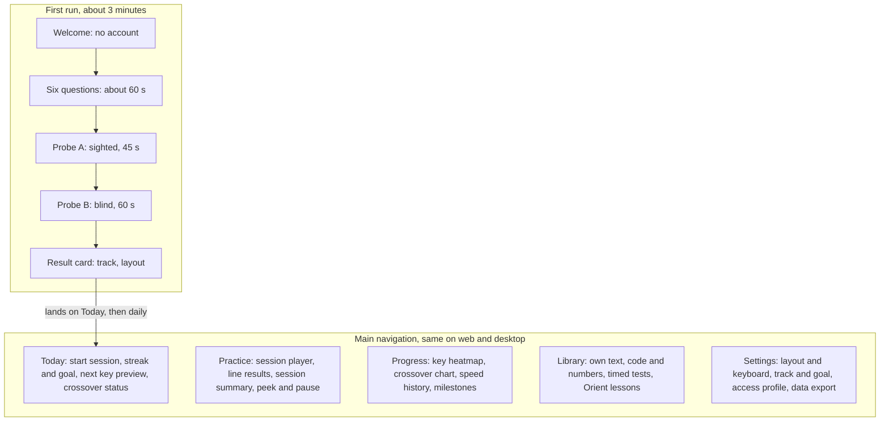

# UX and design spec

## Information architecture

Onboarding runs once; after that the learner lands on Today, where one key press starts the day's session.

## Core user flows

The whole app is usable from the keyboard alone; the mouse is optional everywhere.

1. **First run:** Welcome → six questions → probe A → probe B → result card → Orient lesson (Foundations, Retrain) or first session → session summary → Today.
2. **Daily session:** Today → Enter → **hands-ready gate** (rest fingers on the bumps and press F and J together to begin, so every session starts from home position) → lines, each followed by a result strip → session summary (keys improved, guide changes, crossover progress) → Today.
3. **Unlock moment:** a group unlocks → intro card with the animated reach for both new keys → key drill.
4. **Peek:** hold Ctrl → the full keyboard appears; release → it hides; the peek is logged.
5. **Pause:** Esc pauses and resumes; leaving the window pauses automatically so timing stays honest.
6. **Own text:** Library → paste → preview → practise. The text never leaves the device.
7. **Switch track:** Settings → Track → confirm. Key progress is kept.

## Screen inventory

Fifteen screens cover the MVP. All are wireframed, all are drawn at high fidelity, and the four core illustrations are finished, in the [design snapshots](../design/).

| # | Screen | Wireframe | High fidelity | Key behaviour |
| --- | --- | --- | --- | --- |
| 01 | Welcome | Yes | Yes | Enter starts; no account |
| 02 | Six questions | Yes | Yes (question 2, clickable) | Keys 1–4 pick, Enter continues |
| 03 | Probe A, sighted | Yes | Yes | 45 s; detects the layout silently |
| 04 | Probe B, blind | Yes | Yes | Keyboard hidden, hands shown, honour system |
| 05 | Result card | Yes | Yes | Track, reason, crossover projection, layout confirm |
| 06 | Orient lesson | Yes | Yes (finger zones step), plus illustrations 01–04 | Posture, bumps, finger zones, reach |
| 07 | Today | Yes | Yes | One obvious next action |
| 08 | Hands-ready gate | Yes | Yes | Press F and J together to begin |
| 09 | Practice | Yes | Yes | Per-key fade; hand reach at L0; peek and pause |
| 10 | Line result strip | Yes | Yes (practice states sheet) | Speed, accuracy, slowest key, level changes |
| 11 | Unlock intro card | Yes | Yes, plus reach storyboard | Movement shown before it is typed |
| 12 | Session summary | Yes | Yes | What changed on the guide, slowest pairs, crossover |
| 13 | Progress | Yes | Yes | Mastery heatmap, crossover chart, milestones |
| 14 | Library | Yes | Yes | Own text, code, numbers, timed tests |
| 15 | Settings | Yes | Yes | Layout, track, access profile, sound, data export |

The canvas also holds the **Keyboard component** that every screen reuses. Its props map one to one onto the production component: `mode` (zones, levels, heat, plain), `hands` (none, rest, reach), `target`, `levels`, `heat` and `unit` (key size), plus theme (light or dark).

Beyond the fifteen screens, the canvas covers the moments around them:

| Board | What it shows |
| --- | --- |
| Edge and system states (wireframes 16–24) | No keyboard, input method on, layout mismatch, Caps Lock, paused, break, crossover reached, empty progress, delete everything |
| Practice states (high fidelity) | Line result, peek, Caps Lock warning, paused, break, a key's guide stepping back |
| Practice in dark mode | The dark tokens on the busiest screen |
| Desktop apps | The same app in Windows, macOS and Linux windows; update prompt; daily reminder; import on first launch |
| Phone | The hand-off screen for keyboard-less devices; the public site at phone width |

## Design tokens

The look is calm and precise: warm paper background, ink text, one blue accent, and four finger colours that do the teaching. Tokens live in one JSON file shared by web and desktop.

**Finger colours** come from the Okabe–Ito palette, chosen because it stays distinguishable for common colour-vision deficiencies. Both hands share colours by finger; keys also carry a finger number, so colour is never the only cue.

| Token | Light | Dark | Used for |
| --- | --- | --- | --- |
| `finger.index` (1) | #E69F00 | #F2B33D | Index keys, 2 columns per hand |
| `finger.middle` (2) | #56B4E9 | #7CC6F0 | Middle keys |
| `finger.ring` (3) | #009E73 | #2CC495 | Ring keys |
| `finger.little` (4) | #CC79A7 | #DD9CC0 | Little-finger keys and modifiers |
| `finger.thumb` | #8A8F98 | #A3A8B0 | Space bar |

Key fills use each colour at 22% over the key surface; outlines and fingertip rings use it at full strength.

| Token | Light | Dark | Used for |
| --- | --- | --- | --- |
| `surface.page` | #F6F4EF | #121417 | Page background |
| `surface.card` | #FFFFFF | #1B1E23 | Cards, panels |
| `surface.key` | #FFFFFF | #23272E | Key caps |
| `ink.primary` | #16181D | #ECEAE4 | Text, typed characters |
| `ink.secondary` | #5B616B | #A3A8B0 | Labels, untyped characters |
| `accent` | #2F5BEA | #6E8CFF | Caret, primary buttons, focus ring |
| `state.correct` | #1F8A4C | #4CC27F | Correct feedback |
| `state.error` | #D12F45 | #FF6B7D | Errors |
| `state.warning` | #B7791F | #E5A84B | Slipping keys |

| Type | Font | Size / line height | Notes |
| --- | --- | --- | --- |
| Practice text | JetBrains Mono | 28 / 40 (adjustable 22–40) | Monospace keeps the caret steady |
| Display | Atkinson Hyperlegible, bold | 32 / 40 | Headings, big numbers |
| Body | Atkinson Hyperlegible | 16 / 24 | Designed for legibility |
| Label | Atkinson Hyperlegible | 13 / 18 | Captions, key legends |

Spacing runs on a 4 px base (4, 8, 12, 16, 24, 32, 48, 64). Radii: 6 px keys, 12 px cards, 20 px panels. A 1u key is 48 px with a 6 px gap on desktop. Both fonts are open licence and bundled with the app, never loaded from a CDN.

## Illustration system

Illustrations are the teaching tool, so they are drawn from data, not exported as static images. The keyboard is rendered from the layout definition file, so every new layout gets every illustration for free.

| Illustration | Where it appears | What it teaches |
| --- | --- | --- |
| Finger-zone keyboard | Orient, practice (L0–L1), reference | Which finger owns which key; the F and J bumps |
| Hands at rest | Orient, hands-ready gate | Fingertips on the home row, thumbs over Space, wrists floating |
| Reach animation | Intro cards, L0 practice | The finger lifts from its home key, travels a curved path to the target, returns |
| Posture, side view | Orient, break cards | Screen top near eye level, relaxed shoulders, elbows near 90°, wrists level |
| Fade sequence | Orient, result strip | How the guide will disappear as keys are mastered |
| Key heatmap | Progress | Confidence per key on a single-hue scale, numbers on hover |
| Crossover chart | Progress, Today | Blind speed against the day-1 sighted baseline |

Style rules:

- Flat and geometric: 2 px strokes, rounded joins, no gradients, no drop shadows.
- Hands use a neutral, non-skin tone with finger-colour fingertip rings, so every learner can see their own hands in them.
- Motion: reach 400 ms ease-out, return 250 ms; replaced by a static arrow when reduced motion is on.
- Every illustration has a text alternative describing the action ("Left middle finger moves up from D to E").

## Accessibility requirements

Target: WCAG 2.2 AA across web and desktop. Touch typing is especially valuable to blind and low-vision people, so audio guidance is on the roadmap, not an afterthought.

- [ ] Colour is never the only cue: finger numbers on keys, patterns on the heatmap.
- [ ] All text tokens meet 4.5:1 contrast; large numbers 3:1.
- [ ] Full keyboard navigation; Esc always leaves the typing surface; visible focus ring in the accent colour.
- [ ] Practice text size adjustable 22–40 px; UI follows the operating system's text scaling.
- [ ] Dyslexia-friendly option: alternative font, wider letter spacing, no italics in practice text.
- [ ] Reduced motion: static arrows instead of animated hands; no shaking on errors.
- [ ] One-hand and reduced-finger maps from the Access profile.
- [ ] No time limits while learning; timed tests are opt-in.
- [ ] Screen-reader announcements for results and unlocks through a live region.
- [ ] Audio-guided mode (Phase 4): next word spoken, finger cues spoken ("left middle, up: E").

## Sound and feedback

Feedback is immediate and quiet. Sound is optional and off by default.

| Event | Visual | Sound (optional) |
| --- | --- | --- |
| Correct key | Character turns from secondary to primary ink | Soft key click |
| Wrong key | Expected character tinted red, typed character shown small beneath | Low, short tick |
| Line complete | Result strip slides in | Gentle chime |
| Key fades a level | The key on the mini-keyboard animates to its new state | — |
| Group unlocked | Intro card | Two-note rise |
| Rhythm drill | Pulsing dot | Metronome at the target pace |
