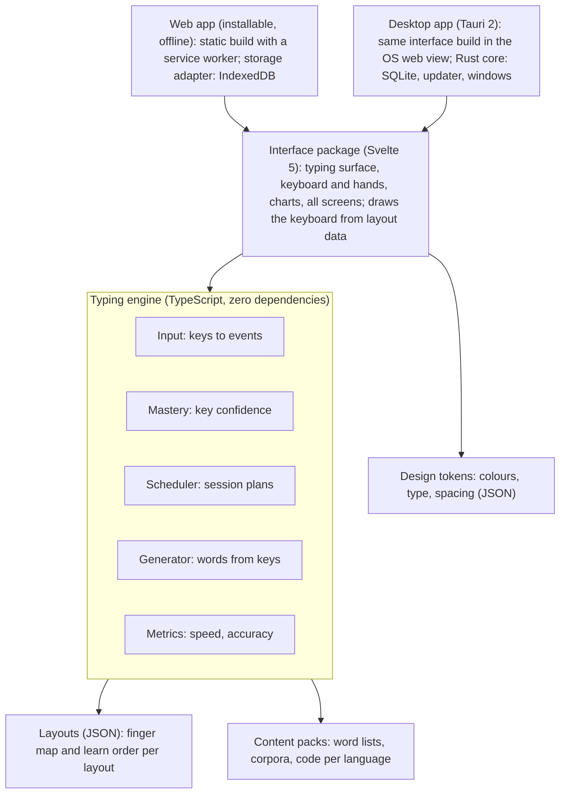
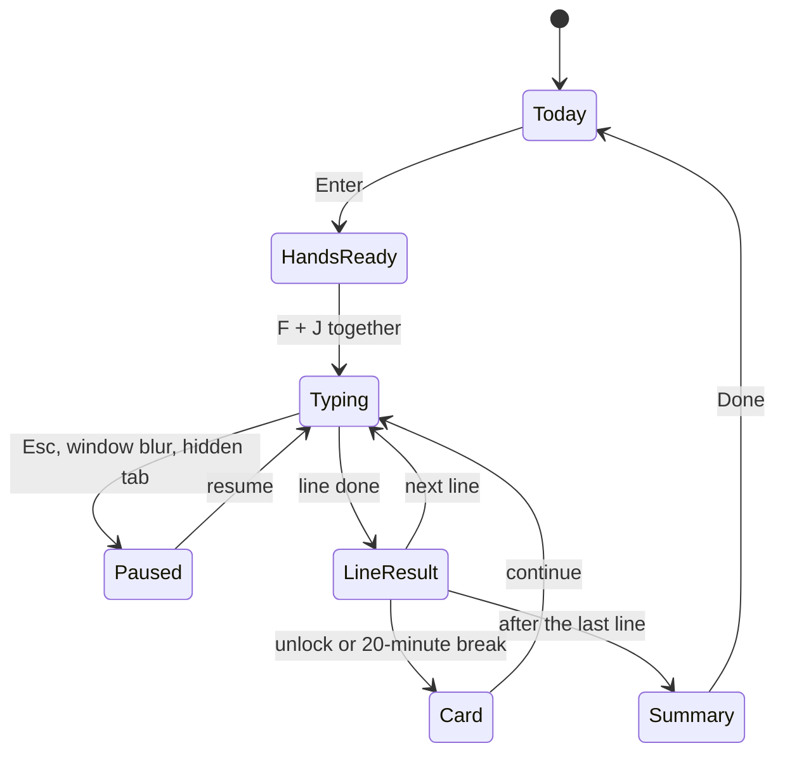

# Technical architecture

## Stack choice

One TypeScript codebase: a zero-dependency typing engine, a Svelte interface, and a thin Tauri shell for desktop. Nothing in the learning loop needs a server.

| Layer | Choice | Alternatives considered | Why this one |
| --- | --- | --- | --- |
| Language | TypeScript, strict mode | — | One language across engine, interface and tests |
| Typing engine | Plain TypeScript package, no dependencies | Rust compiled to WebAssembly | Fast to iterate; move hot paths to WebAssembly only if profiling demands it |
| Interface | Svelte 5 with Vite | React, SolidJS, plain Web Components | Compiles to small plain JavaScript; fine-grained updates suit per-keystroke rendering. SolidJS is a close second |
| Styling | CSS custom properties generated from the tokens file | Tailwind, CSS-in-JS | Same tokens on web and desktop; no runtime styling library |
| Web app | Static build, installable, offline via service worker | Server-rendered framework | No backend needed; hosts on any static host or CDN |
| Desktop | Tauri 2 | Electron; Flutter; native app per OS | Small installers using the OS web view, Rust core. Electron gives identical Chromium everywhere at the cost of much larger installers; Flutter means a second interface codebase; native means three |
| Storage | IndexedDB on web, SQLite on desktop, behind one interface | localStorage | Structured history, room to grow, queryable |
| Tests | Vitest for the engine, Playwright for end-to-end | Jest, Cypress | Playwright drives Chromium, Firefox and WebKit, which approximates the macOS and Linux desktop web views |

On "no external runtime dependencies": the engine has none; Svelte compiles away; fonts and content are bundled. The one system dependency is the Linux web view (WebKitGTK): .deb and .rpm declare it as a package dependency, and the Phase 3 spike confirms how AppImage and Flatpak carry it.

## System architecture



Arrows point to what each part uses. The engine never touches the DOM, storage or the network; the apps inject a storage adapter and feed it keyboard events, so the same engine runs in tests, the browser and every desktop shell.

## Repository layout

A single monorepo with pnpm workspaces. Layouts, content and tokens are data packages, so adding a language or layout needs no code change.

```text
eyesup/
├── apps/
│   ├── web/                 # Svelte + Vite, installable web app, service worker
│   │   └── src/storage/     # IndexedDB adapter
│   └── desktop/             # Tauri 2 shell, loads the apps/web build
│       └── src-tauri/       # Rust: SQLite adapter, updater, window state
├── packages/
│   ├── engine/              # zero-dependency TS: input, mastery, scheduler, generator, metrics
│   ├── ui/                  # Svelte components: TypingSurface, Keyboard, Hands, charts
│   ├── layouts/             # qwerty-us.json, qwerty-uk.json, azerty-fr.json, ...
│   ├── content/             # word lists, Markov models, phrases, code snippets per language
│   └── tokens/              # design tokens JSON -> CSS variables
├── docs/                    # this plan as Markdown, plus architecture decision records
│   └── adr/
├── tests/e2e/               # Playwright, including the keyboard-event matrix
└── .github/workflows/       # test, build web, build desktop per OS
```

A layout file (fingers L1–L4 and R1–R4 run index to little, matching the colour token numbers; T is the thumb):

```json
{
  "id": "qwerty-us",
  "name": "English (US) QWERTY",
  "fingerprint": { "KeyQ": "q", "KeyY": "y", "KeyE": "e" },
  "keys": [
    { "code": "KeyF", "base": "f", "shift": "F", "finger": "L1", "row": 2, "home": true, "bump": true },
    { "code": "KeyE", "base": "e", "shift": "E", "finger": "L2", "row": 1 },
    { "code": "Space", "base": " ", "finger": "T", "row": 4 }
  ],
  "learnOrder": [["KeyF", "KeyJ"], ["KeyD", "KeyK"], ["KeyS", "KeyL"], ["KeyA", "Semicolon"], ["KeyE", "KeyI"]]
}
```

## Keyboard input handling

The hardest engineering in a typing tutor is reading keystrokes correctly on every OS, browser and layout. The engine receives clean events; all platform quirks are handled in one input adapter.

| Concern | Rule |
| --- | --- |
| Physical key vs character | `event.code` (physical position) maps to the finger through the layout file; `event.key` is the character produced and is compared with the expected character |
| Timing | Use `event.timeStamp` (same high-resolution clock as `performance.now()`), never `Date.now()`; record keyup times for rollover |
| Dead keys | A keydown reporting `Dead` (for example ^ then e on AZERTY gives ê) is held until the composed character arrives; one target character, two keystrokes |
| AltGr | Windows reports AltGr as Ctrl+Alt; check `getModifierState('AltGraph')` before treating Ctrl as a shortcut |
| Input methods (IME) | Composition-based languages are out of scope for v1; when `isComposing` is true, show a notice instead of scoring |
| Auto-repeat | Ignore events with `repeat` set |
| Browser shortcuts | Inside the typing surface only, prevent defaults for Space (scroll), Backspace, ' and / (Firefox quick find); Cmd and Ctrl shortcuts pass through |
| Caps Lock | Detect with `getModifierState('CapsLock')` and show a warning |
| Focus | Window blur or a hidden tab pauses the session, so idle time never counts |
| Latency | Keydown to painted character within one frame (16 ms); only changed characters re-render |

1. **Keyboard event:** keydown and keyup from the browser or desktop web view (`code`, `key`, `timeStamp`, `repeat`).
2. **Input adapter:** drops auto-repeat events; holds dead keys until composed; reads AltGr and Caps Lock; stops scoring during IME input.
3. **Engine compares:** maps `code` to finger (layout); checks `key` against the expected character; times keydown to keydown; measures overlap for rollover.
4. **Paint, first:** only the changed characters, caret, key glow and hands. Under 16 ms to the screen.
5. **Learn:** key and pair confidence; picks the next focus key; fades or restores the guide.
6. **Save:** line result written after every line, never mid-line (IndexedDB or SQLite).

Steps 4, 5 and 6 all follow step 3, in that order of priority.

The adapter is the only platform-specific code; everything to its right runs unchanged in the browser, in tests and in every desktop build. Painting comes first, so learning and saving can never delay the next character.

## Practice session states



| State | What it shows |
| --- | --- |
| Today | Session plan ready |
| HandsReady | Rest on F and J, then press both |
| Typing | The line; hold Ctrl to peek; errors per the track's rule. The only state where the timer runs |
| Paused | Timer stopped, nothing scored |
| LineResult | Speed, accuracy, slowest key, guide-level changes |
| Card | New keys: the reach animation. 20 minutes of typing: a stretch break |
| Summary | What changed, crossover gain |

The session player is a small state machine. Pausing is always possible while typing, and the timer only runs in "Typing a line", so speed figures never include idle time.

## Data model

All records live on the device. Statistics are kept per layout, so learning AZERTY never overwrites QWERTY progress.

| Entity | Key fields | Notes |
| --- | --- | --- |
| Profile | layout, track, overlays, access profile, daily minutes, target WPM, goal | One per device until accounts exist |
| Baseline | probe A and B results, home-position score, date | Written once; never edited |
| KeyStat | layout, key code, accuracy, time-to-type, guide level, last practised, stable sessions, presses | One row per key per layout |
| PairStat | layout, letter pair, time, accuracy, count | Drives Chunk-stage drills |
| Session | start, duration, track, net WPM, accuracy, blind share, peeks | About 1 KB each |
| LineResult | session, line type, WPM, accuracy, errors by key | Own-text lines store a hash, never the text |
| Keystroke log | timestamp, code, key, expected, correct, keyup time | Rolling 14 days, optional, for debugging and research |
| Milestone | id, date | — |
| OwnText | title, text, date | Never synced, never sent anywhere |

Settings offers a full JSON export and a delete-everything button.

## Storage, privacy and security

Typing rhythm can identify a person, so EyesUp treats keystroke timing as sensitive data and keeps it on the device.

- **Local-first.** No account and no server in the learning loop. Analytics, if any, are opt-in and aggregate only (session-level numbers, no text, no keystroke logs).
- **No keylogger behaviour.** The desktop app reads keys only while its own window is focused. No global keyboard hooks, no accessibility permissions, nothing in the background. This also avoids antivirus flags and macOS permission prompts.
- **Locked-down web view.** Content Security Policy allows only the app's own origin; no remote scripts; fonts bundled. Tauri capabilities are limited to the app data folder and the updater.
- **Signed everything.** Installers are code-signed per OS; updates are signed and verified by the Tauri updater.
- **Supply chain.** Lockfiles committed; `npm audit` and `cargo audit` run in CI; signing keys only in CI secrets.
- **Accounts later.** When optional accounts and sync arrive (Phase 4), they come with an age gate, parental consent for under-13s, and end-to-end encryption of synced progress.

## Performance budgets and testing

| Budget | Target |
| --- | --- |
| Keystroke to painted character | Under 16 ms at the 95th percentile on a mid-range 2018 laptop |
| Web app JavaScript | Under 200 KB gzipped, content packs loaded per language |
| Desktop cold start | Under 1.5 s |
| Desktop installer | Under 15 MB per OS |
| Memory in a session | Under 150 MB |

Testing layers:

- **Engine unit tests (Vitest)**, including property tests: generated lines use only unlocked keys; focus-key share stays within 25–35%.
- **Layout checks:** every printable key has a finger; the learn order covers every key exactly once.
- **Keyboard-event matrix:** automated in Chromium, Firefox and WebKit, plus a manual checklist on real machines for Windows, macOS, Ubuntu, Kali and Fedora, with US, UK and AZERTY keyboards, dead keys, AltGr and Caps Lock.
- **Usability:** five learners per phase, thinking aloud through onboarding and the first session.
- **Learning effect:** beta cohort takes the blind probe again at weeks 2 and 4; the eyes-up rate comes from this.
